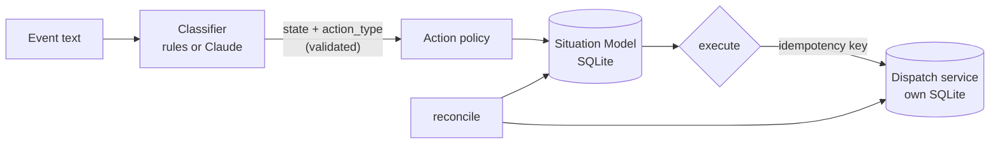

# Situation Model

A working implementation of the [AI Operations Situation Model](https://github.com/bVan566/ai-operations-situation-model). Operational events are classified into `NOW`, `NEXT`, `WAITING`, `DECISIONS` or `WATCHING`. Each item gets an owner, an authority level and a terminal condition. Deterministic code decides whether an action may run, executes it against an external service, and reconciles when the two systems disagree. A Failure Lab in the UI lets you break it on purpose.

**No API key is needed.** The app, tests, evaluations and Failure Lab all run on the deterministic rules classifier. Claude-assisted classification is an optional add-on that switches on when you supply your own key.

## The problem

Knowing that something should happen is not permission to make it happen. An urgent refund belongs in `NOW` and still needs a human's approval. And when an external action succeeds, the tracker may never hear about it. If the tracker still says "pending", someone retries and the customer gets refunded twice.

## What it does

- Takes a free-text operational event and classifies it (deterministic rules by default; Claude is optional)
- Assigns authority from a fixed action policy: `autonomous`, `approval_required` or `human_only`
- Blocks gated actions until a human approves that specific item. Never executes human-only actions.
- Executes approved actions against a simulated dispatch service with its own database, and closes items only on a verified result
- Reconciles internal state against the dispatch service's records, and blocks duplicate execution
- Persists items, history and action attempts in SQLite

## Architecture



**Where AI ends:** the classifier only turns text into two fields, `state` and `action_type`, both from a closed vocabulary. Its output is validated, and output that tries to set authority is rejected. Everything after that is ordinary code and never calls the model:

| Control | Enforced in |
| --- | --- |
| Authority per action type | `src/policy.ts` (table lookup) |
| Human-only items forced to `DECISIONS` | `Engine.createItem` |
| Approval required, and bound to one item and action type | `Engine.approve`, `Engine.execute` |
| Allowed state transitions, `CLOSED` terminal | `src/domain.ts` `ALLOWED_TRANSITIONS`, `Engine.move` |
| Duplicate prevention (internal state + external ledger + idempotency keys) | `Engine.execute` |
| Close only on a verified external result | `Engine.verifyAndClose` |
| Reconciliation rules | `Engine.reconcile` / `reconcileAttempt` |

The model is called in exactly one place (`Engine.intake`). A test enumerates every possible classifier output (5 states × 9 action types) and checks that no gated action ever reaches the dispatch service without approval.

**The default is no API key.** Intake uses the rules classifier. When Claude is enabled but errors, refuses, or returns malformed or invalid output, intake falls back to the same rules, and each item records which classifier produced it. The controls never depend on which classifier ran. What Claude would add is better interpretation of wording the rules don't know. The rules scored 72.5% on held-out events; Claude has not been measured on them.

## Run it

Requires **Node.js 24.2 or later** (Node runs the TypeScript directly; no build step).

```bash
git clone https://github.com/bVan566/situation-model-demo.git
cd situation-model-demo
npm install
npm start            # http://localhost:3000
```

That's all you need. Everything in this README works without a key.

**Optional: Claude-assisted classification.** Uses your own paid Anthropic API key. Run `cp .env.example .env`, set `ANTHROPIC_API_KEY`, restart, then choose "Claude" in the classifier dropdown. The model defaults to `claude-opus-5-5` at low effort (override it with `SITUATION_MODEL_LLM`). Without a key that option is disabled, and an invalid key falls back to rules.

Data persists in `data/` (created on first run; change it with `SITUATION_DATA_DIR`). **Reset data** in the UI clears it. `PORT` and `HOST` (default `127.0.0.1`) can also be set in `.env`. For a terminal-only walkthrough, run `npm run demo`.

## Failure Lab

Each button in the UI prepares one failure and selects the item. You perform the last step yourself.

| Scenario | Initial condition | You do | Protection | You observe |
| --- | --- | --- | --- | --- |
| Stale state | A reply was delivered, but the process crashed before recording it | **Reconcile this item** | Reconciler reads the dispatch ledger as the source of truth | Before: `in_flight` vs `succeeded`, highlighted. After: item `CLOSED`, both columns `succeeded` |
| Duplicate action | Reply sent, verified, item `CLOSED` | **Execute** | Duplicate check on internal state and the external ledger | `BLOCKED (duplicate)`, side effects stay at 1 |
| Authority violation | Urgent refund in `NOW`, approval pending | **Execute** | Authority gate before any external call | `BLOCKED (authority)`, no external record. Approve, then Execute: item closes |
| External failure | Status update submitted, dispatch service returned a failure | Look at the item, then **Decide: retry** or **Record decision & close** | A failure is never reported as complete | Item in `DECISIONS`, action `failed`, no closed reason, 0 side effects |

You can also inject faults on any item with the dropdown beside **Execute**: failure, timeout (item goes to `WAITING` with status `unknown` until reconciled), or crash after success.

## Tests

```bash
npm test             # node:test, runs offline, no API key needed
npm run typecheck
```

The tests cover:
- classification and routing, and output validation
- authority gates, approvals and precedent (approving one item authorizes nothing else)
- valid and invalid transitions, and `CLOSED` as terminal
- external success, failure and timeout
- reconciliation: stale, pending, in-transit, undelivered, and unverifiable success
- duplicate prevention
- LLM fallback on API error, refusal, missing text, malformed JSON, invalid output, and no key (with a fake client)
- all four Failure Lab scenarios
- the HTTP API

## Evaluation

Exact definitions and limits are in [`eval/README.md`](eval/README.md). Raw results are in [`eval/results/`](eval/results/).

**Classification** (`npm run eval`): 40 hand-written, labeled held-out events, written after the rules were frozen and run once. The rules classifier scored **29/40 (72.5%)** on state and 29/40 on action type. In 5 cases an action needing approval went unrecognized. It became a non-executable `none`, so the error was misrouting, not an unauthorized action. On the 30 dev cases used to write the rules it scores 100%, which is in-sample and not meaningful.

**The Claude classifier has no published result.** One attempted run failed with an invalid key: every call returned 401, and no model output was produced. That run is kept in `eval/results/` for transparency, marked as aborted. It is not a performance result. With your own key you can run the pre-registered protocol in [`eval/README.md`](eval/README.md) with `npm run eval -- --classifier llm`.

**Control path** (`npm run eval:scenarios`): seeded, generated workloads of **1,000 items on each of 3 seeds** (1, 7, 123). They mix all authority levels with injected failures, timeouts, crashes after success, early execute attempts and double clicks. An item fails on any of:
- a side effect that wasn't authorized
- more than one side effect
- a lost or unknown result that was never detected
- internal/external disagreement after reconciliation

**Result: 0 failed items on each seed.** The same workloads through a naive executor fail 533–571 items per seed. This evaluates the deterministic control path against a simulated service in a single process. It does not measure classification, real-API behavior, concurrency, or production reliability.

## Key engineering decisions

- **Authority is a property of the action, not the model's confidence.** A misclassified event can pick the wrong action. It can never run a gated action without approval, because authority is checked against the action actually sent downstream.
- **Write-ahead attempts with stable idempotency keys** (`item:action:attempt`). A crash leaves evidence, and a resubmission cannot repeat a side effect. An in-flight attempt with no external record is treated as possibly in transit for 60 seconds before it may be retried.
- **The external system is the source of truth for side effects.** Items close only on a verified result. A timeout is "unknown", not success. Internal "success" with no external record is routed to a human, not accepted.
- **Small stack.** Node's built-in `node:sqlite`, `node:http` and `node:test`. The only runtime dependency is the Anthropic SDK, for the optional classifier.

## Related architecture

Design rationale, state definitions and failure modes: [bVan566/ai-operations-situation-model](https://github.com/bVan566/ai-operations-situation-model). A 60-second demo sequence is in [`docs/DEMO_SCRIPT.md`](docs/DEMO_SCRIPT.md).

## Author

**Billy VanVorst**  
Applied AI Systems & Automation  
Founder, bVan! Systems
